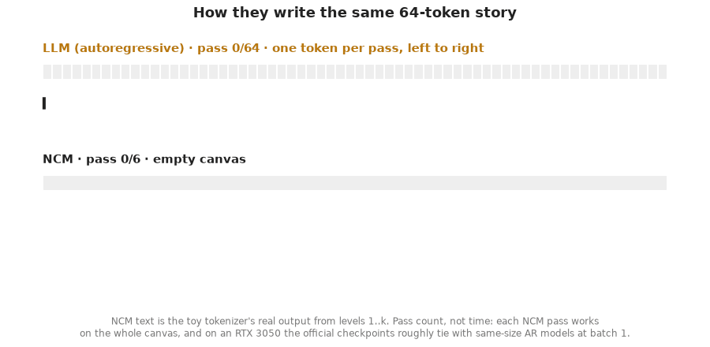
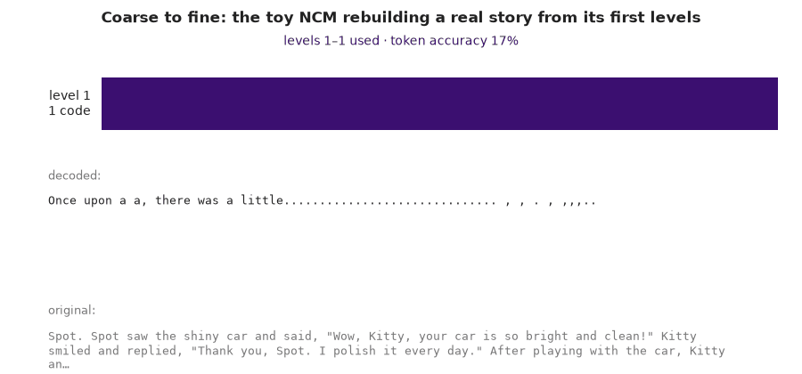
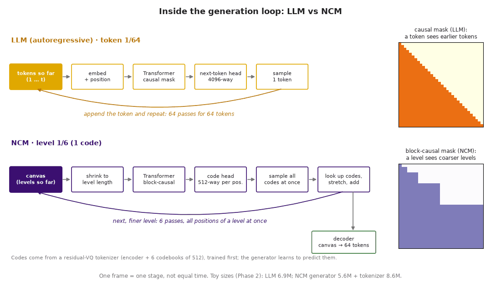
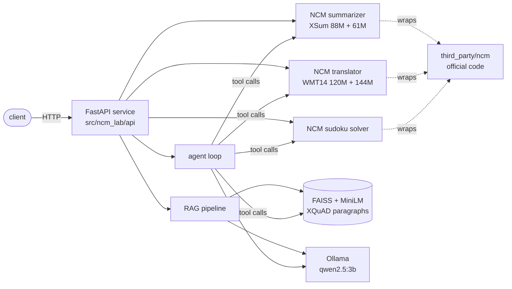

# NCM Lab: Next-Concept Models on a Laptop GPU

[](https://github.com/Aymenrahmanii/NCM/actions/workflows/ci.yml)


[](LICENSE)
[](https://doi.org/10.5281/zenodo.23837502)

An independent study of **Next-Concept Modeling (NCM)**, a new text generation method from
Hazy Research ([paper](https://arxiv.org/abs/2610.14162), [code](https://github.com/HazyResearch/ncm))
that writes text coarse to fine instead of one token at a time and is reported to be up to
**31× faster**. This project asks what that speed means on an ordinary laptop GPU, at what
quality, and whether it helps inside real RAG and agent pipelines.

It goes from a toy NCM built from scratch to the official checkpoints, a fair benchmark
against autoregressive models and a 3B LLM, a FastAPI service, a suite of 8 experiments
that push NCM until it breaks, and a controlled scale-up on TinyStories. Every number is
reproducible from this repository.

**📄 Report (PDF): [paper/ncm-limits-report.pdf](paper/ncm-limits-report.pdf)** · archived on Zenodo: [doi.org/10.5281/zenodo.23837502](https://doi.org/10.5281/zenodo.23837502)
(version of 31 Oct 2026; the numbers below have since been re-measured on full test sets)

*Aymen Rahmani, final-year Data Science Engineering student. Personal learning project.*

## How NCM writes text

An autoregressive (AR) model, like a typical LLM, writes one token per forward pass, left to
right. NCM writes a whole **level** per pass: first a single "gist" code for the entire text,
then 4, 8, 16, … codes, each level refining the canvas left by the previous ones, until
there is one code per token.



Fewer passes is not the same as less time: every NCM pass processes the whole canvas, and on
this GPU the official checkpoints roughly tie with same-size AR models at batch 1 (see below).

What the levels hold, shown with the toy NCM tokenizer from Phase 2 rebuilding a real test
story from its first 1, 2, …, 6 levels (real decoder output, not an illustration):



## How NCM is built, next to an LLM

Both are Transformers; what differs is what they predict and what each position may see.
An LLM predicts the next token with a **causal** mask (each token sees the earlier ones).
NCM has two parts: a **residual-VQ tokenizer**, trained first, that turns text into a code
per position at each level, and a **generator** that predicts all codes of a level at once
with a **block-causal** mask (each level sees the coarser ones, never finer ones). A decoder
turns the finished canvas back into tokens.



All three animations are drawn from result files and the Phase 2 model shapes by
`python scripts/make_readme_gifs.py`.

## Key findings

| question | answer (RTX 3050 6 GB) |
|---|---|
| What is the "31×" measured against? | A **diffusion** language model (128+ steps) on an H100 with 1024-token outputs, not the GPT-style autoregressive (AR) models most people use. |
| Is NCM faster than a same-size AR model? | **At batch 1, no:** interleaved timing gives a tie on XSum (NCM ÷ BART 0.99) and opus-mt 1.26× faster on WMT14; against a compiled AR model NCM is 2.2–2.9× slower. At batch 32 the official code is 2.6–9.8× slower; with the KV-cache fix (upstream PR #5) it is **level on WMT14** and 2.2× slower on XSum, at unchanged quality. |
| At what quality? | It reproduces the paper (XSum ROUGE-L 27.9 vs 28.0; Sudoku-hard 84.5% vs 86.1%) but trails pretrained AR models on the full test sets: ROUGE-L 27.9 vs 33.3, BLEU 21.7 vs 33.1 (both gaps significant). |
| Where does it break? | Its fixed output canvas caps every output at about 23 words, so translation BLEU falls from 16.3 to 0.04 as inputs grow. It repeats itself in 36–38% of outputs (AR: 5–13%). Sudoku drops from 84% to 32% with five clues removed, and it "solves" unsolvable puzzles. |
| vs a 3B general LLM (qwen2.5:3b)? | NCM is 2–3.5× faster and better at news summaries (ROUGE-L 27.6 vs 19.7) but worse at translation (BLEU 16.2 vs 21.9). Small trained AR models beat both. |
| Does speed matter in RAG and agents? | **No.** On all 1,190 XQuAD questions, NCM context compression cut RAG accuracy from 73% to 7% (BART: 10%); NCM translation gave 38% vs 56% for a small AR translator; in the agent the LLM takes 91–97% of the time. |
| And at long outputs, where the 31× was measured? | With everything compiled, NCM is **6–10× faster than GPT-2 small** at batch 1 from 128 to 1,024 tokens, but the lead does not grow with length and shrinks to 1.1× at batch 8 and 512 tokens. Quality at 128 tokens: MAUVE 0.80 vs 0.95 for a same-domain AR model. Above 128 tokens only speed is measured (no public checkpoint). |
| Why are small NCMs incoherent? | The finest level breaks coherence: generating only that level, with every coarser level real, raises GPT-2 perplexity from 15.5 to 111. Sampling explains about a third; the rest is capacity and data. A controlled scale-up (same data, BPE and budget for NCM and an AR ladder) is running. |

Full write-ups: [Phase 2](docs/phase2.md) · [Phase 3](docs/phase3.md) ·
[Phase 4](docs/phase4-results.md) · [Phase 5](docs/phase5.md) · [Phase 6](docs/phase6.md) ·
[Limits suite](docs/limits.md) · [Phase 9](docs/phase9.md) · [Phase 10](docs/phase10.md) ·
[Research plan and status](docs/research-plan.md)

## Project phases

| phase | what I built | where |
|---|---|---|
| 1 | PyTorch basics: a character-level model; why parallel generation is fast | `scripts/`, [docs](docs/phase1.md) |
| 2 | A toy NCM from scratch: multiscale VQ tokenizer, coarse-to-fine generator, AR baseline | `src/ncm_lab/toy_ncm/`, [docs](docs/phase2.md) |
| 3 | Clean wrappers for the official NCM checkpoints, validated against the official evaluation | `src/ncm_lab/models/`, [docs](docs/phase3.md) |
| 4 | A fair benchmark on full test sets: quality, latency, throughput and memory vs same-size AR models | `src/ncm_lab/bench/`, [docs](docs/phase4-results.md) |
| 5 | NCM as a tool: RAG compression, multilingual RAG, and a hand-written tool-calling agent | `src/ncm_lab/rag/`, `src/ncm_lab/agents/`, [docs](docs/phase5.md) |
| 6 | A production-style API: validation, timeouts, GPU lock, logging, metrics, Docker, CI | `src/ncm_lab/api/`, [docs](docs/phase6.md) |
| 7 | Limits suite: input/output length, batch size, faithfulness, robustness, sudoku, LLM, agent | `src/ncm_lab/limits/`, [docs](docs/limits.md) |
| 8 | Benchmark repair: KV-cache bug bisected (same fix as upstream PR #5), interleaved timing with bootstrap CIs, compiled AR, CPU | `src/ncm_lab/bench/`, [docs](docs/phase4-results.md) |
| 9 | Long outputs (128–1,024 tokens) vs GPT-2 and TinyStories-33M, with MAUVE | `src/ncm_lab/bench/long_outputs.py`, [docs](docs/phase9.md) |
| 10 | Which level breaks coherence, then NCM vs an AR ladder trained on identical data (in progress) | `src/ncm_lab/toy_ncm/diagnose.py`, `src/ncm_lab/scale/`, [docs](docs/phase10.md) |
| – | A report generated from the result files | `paper/` |

## Tech stack

| area | tools |
|---|---|
| Modeling | PyTorch (CUDA, bf16/fp16, `torch.compile`), Hugging Face Transformers & Tokenizers, official NCM code (Hydra / OmegaConf) |
| Baselines | BART-base (XSum), opus-mt-de-en (MarianMT), GPT-2, TinyStories-33M, qwen2.5:3b via Ollama |
| Evaluation | ROUGE (`rouge-score`), BLEU and chrF (`sacrebleu`), MAUVE, paired bootstrap CIs, custom faithfulness and robustness checks |
| RAG & agents | sentence-transformers (MiniLM), FAISS, XQuAD, a plain-Python tool-calling loop |
| Serving | FastAPI, Pydantic, pydantic-settings, Uvicorn, Prometheus metrics, structured JSON logs |
| Engineering | pytest (97 CPU tests, GPU tests marked separately), ruff, pre-commit, GitHub Actions, Docker Compose with GPU |
| Analysis & writing | matplotlib, LaTeX |
| Hardware | RTX 3050 Laptop GPU (6 GB), WSL2 Ubuntu 24.04, CUDA 13 |

## Architecture



## Quick start

**No GPU needed.** The API and the test suite run with tiny stand-in models:

```bash
git clone https://github.com/Aymenrahmanii/NCM.git ncm-lab && cd ncm-lab
python -m venv .venv && source .venv/bin/activate
pip install torch --index-url https://download.pytorch.org/whl/cpu && pip install -e ".[dev]"
NCM_BACKEND=fake pytest -q -m "not gpu"                  # 97 tests
NCM_BACKEND=fake uvicorn ncm_lab.api.main:app            # docs at http://localhost:8000/docs
```

**Full reproduction** (NVIDIA GPU, WSL2 Ubuntu):

```bash
pip install torch --index-url https://download.pytorch.org/whl/cu130 && pip install -e ".[dev]"
bash scripts/download_data.sh && bash scripts/download_ncm.sh          # ~2.5 GB
bash scripts/install_ollama_user.sh && (bash scripts/ollama.sh serve &) && bash scripts/ollama.sh pull qwen2.5:3b
bash scripts/reproduce_results.sh phase2-train                          # toy NCM, ~1 h
bash scripts/reproduce_results.sh                                       # every number in results/
python -m ncm_lab.limits.run --list                                     # the 8 limits experiments
python -m ncm_lab.toy_ncm.diagnose                                      # Phase 10 level diagnostic, ~5 min
python -m ncm_lab.scale.data && bash scripts/phase10_train.sh           # Phase 10 scale-up, ~24 GPU-hours, resumable
bash paper/build.sh                                                     # rebuild the report
```

**Serve the real models:**

```bash
cp .env.example .env
uvicorn ncm_lab.api.main:app --port 8000        # /summarize /translate /sudoku/solve /rag/query /agent/run
docker compose up --build                       # or with Docker (GPU via the NVIDIA Container Toolkit)
```

## Repository structure

```
src/ncm_lab/
  toy_ncm/    toy NCM from scratch (phase 2) and the level diagnostic (phase 10)
  scale/      configurable NCM + AR ladder, resumable training, evaluation (phase 10)
  models/     wrappers for the official checkpoints + AR baselines
  bench/      benchmark harness, interleaved timing, long outputs, charts
  rag/        retrieval, RAG pipeline, experiments
  agents/     tool-calling agent and its tools
  api/        FastAPI service
  limits/     the 8 limits experiments + report generator
tests/        CPU tests (fake models) and GPU tests
scripts/      setup, downloads, reproduction, profiling, README animations
results/      every CSV, chart and model output quoted in the docs
docs/         one write-up per phase, research plan, README animations
paper/        LaTeX report, generated tables, PDF
```

## Limitations

- **One GPU, one machine.** Every speed number is from an RTX 3050 6 GB laptop under WSL2.
  Results on an H100 can differ.
- **Pretrained baselines.** BART-base and opus-mt start from large-scale pretraining; the NCM
  checkpoints were trained from scratch on XSum / WMT14, so the quality gap mixes method and
  pretraining. Phase 10 removes this confound by training NCM and AR on identical data.
- **Evaluation sets.** Phase 4 and RAG use full test sets (XSum 11,334, WMT14 3,003, all
  1,190 XQuAD questions) with 95% intervals; the agent has six tasks and the limits suite
  uses 100–500 examples per task: enough for large effects, not small ones.
- **No long-output checkpoint.** Above 128 tokens, Phase 9 measures speed with random weights.
- **Simple metrics.** RAG accuracy also reports exact match and token F1; faithfulness uses
  string proxies, not human judgment.
- **No diffusion baseline.** The 31× claim itself was not re-measured.
- **NCM outputs hallucinate** names and figures; do not use them unchecked.

## Acknowledgements

NCM code and checkpoints: [Hazy Research](https://github.com/HazyResearch/ncm). Datasets: XSum,
WMT14, XQuAD, TinyStories and Tiny Shakespeare. Parts of the code, documentation and report were
written with the help of an AI assistant (Claude, Anthropic); I ran every experiment, and every
number comes from the files in `results/`.

## How to cite

```bibtex
@techreport{rahmani2026ncm,
  title       = {Next-Concept Models on a Laptop GPU: A Fair Benchmark Against Autoregressive
                 Models, and What Their Speed Is Worth in RAG and Agents},
  author      = {Rahmani, Aymen},
  year        = {2026},
  institution = {Independent learning project},
  doi         = {10.5281/zenodo.23837502},
  url         = {https://doi.org/10.5281/zenodo.23837502}
}
```

## License

[MIT](LICENSE) for this repository's code and documentation. The official NCM code
(`third_party/ncm`, downloaded separately), the model checkpoints and the datasets keep their own
licenses.
