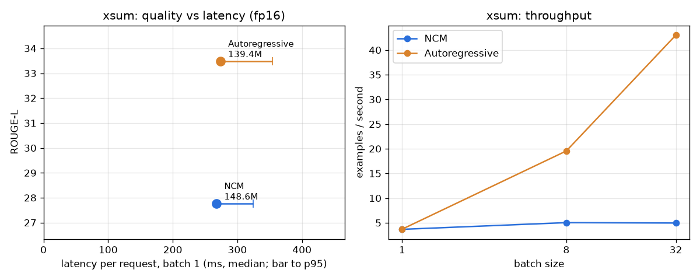
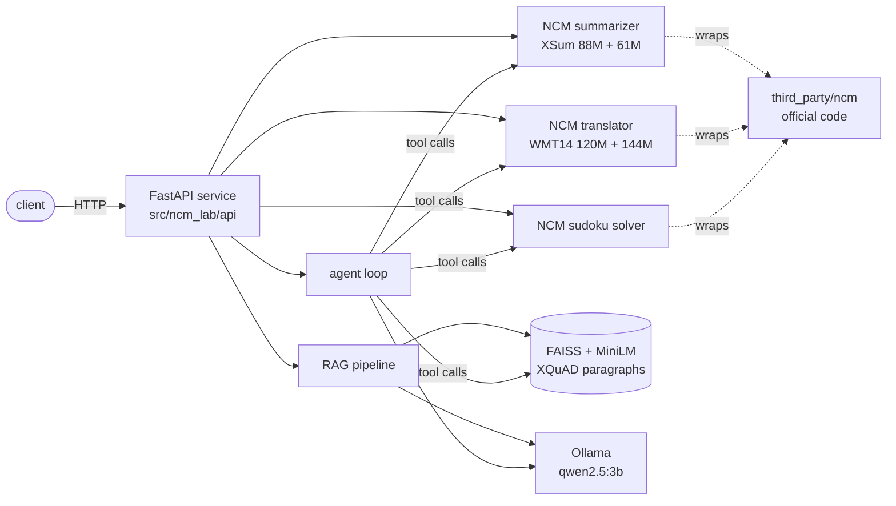

# ncm-lab

**How much faster is Next-Concept Modeling (NCM) than a same-size autoregressive model on a
laptop GPU, at what quality, and does that speed matter inside a real RAG or agent pipeline?**

NCM ([paper](https://arxiv.org/abs/2610.14162), [code](https://github.com/HazyResearch/ncm),
Hazy Research, Oct 2026) generates text coarse to fine: a tiny "gist" first, then longer
and longer refinements, predicting every position of a level in parallel. This repo builds a
toy NCM from scratch, runs the official checkpoints behind a clean wrapper, benchmarks them
fairly against autoregressive (AR) models on an **RTX 3050 6 GB**, uses them as tools in RAG
and an agent, and serves everything through a production-style API.

## Results in one table

| question | answer on an RTX 3050 |
|---|---|
| Is NCM faster than a same-size AR model? | **At batch 1: about the same** (XSum 268 vs 274 ms) **or 1.2× faster** (WMT14), with a tighter p95. **At batch 32: 2.3–8.7× slower.** |
| At what quality? | Matches the paper (XSum ROUGE-L 27.8 vs 28.0; Sudoku-hard 84.5% vs 86.1%), but **below pretrained AR models**: ROUGE-L 27.8 vs 33.5, BLEU 20.0 vs 30.8. |
| What does "31×" mean? | NCM vs a **diffusion** LM (128+ steps) on an H100 with 1024-token outputs, not vs GPT-style AR models. |
| Does the speed matter in RAG / agents? | **No.** Compressing chunks with NCM cut RAG accuracy from 87.5% to 10%; NCM translation lowered multilingual RAG accuracy (37.5% vs 67.5%) and was 2× slower in bulk; in the agent the LLM takes 91–97% of the time. |
| Toy NCM (Phase 2) | Coarse-to-fine works (reconstruction 17% → 98.7% over 6 levels); 9.3× faster than a toy AR model at batch 1, 3.0× at batch 128, but far less fluent. |

Full write-ups: [Phase 2](docs/phase2.md) · [Phase 3](docs/phase3.md) ·
[Phase 4](docs/phase4-results.md) · [Phase 5](docs/phase5.md) · [Phase 6](docs/phase6.md)



## Architecture



## Repository

| path | phase | what |
|---|---|---|
| `scripts/char_model.py`, `scripts/parallel_vs_sequential.py` | 1 | PyTorch basics, char-level AR model, why parallel generation is fast |
| `src/ncm_lab/toy_ncm/` | 2 | toy NCM from scratch: multiscale VQ tokenizer, generator, AR baseline, evaluation |
| `src/ncm_lab/models/` | 3–4 | `NCMSummarizer`, `NCMTranslator`, `NCMSudokuSolver`; AR baselines |
| `src/ncm_lab/bench/` | 4 | benchmark harness (quality + latency + throughput + memory) and charts |
| `src/ncm_lab/rag/`, `src/ncm_lab/agents/` | 5 | RAG pipeline, experiments, hand-written tool-calling agent |
| `src/ncm_lab/api/` | 6 | FastAPI service, settings, schemas, model registry |
| `results/` | all | every CSV, chart and sample output quoted in the docs |
| `docs/` | all | one write-up per phase |

## Setup (WSL2 Ubuntu, NVIDIA GPU)

```bash
git clone https://github.com/Aymenrahmanii/NCM.git ncm-lab && cd ncm-lab
curl -LsSf https://astral.sh/uv/install.sh | sh && uv venv --seed .venv && source .venv/bin/activate
pip install torch --index-url https://download.pytorch.org/whl/cu130 && pip install -e ".[dev]"
bash scripts/download_data.sh && bash scripts/download_ncm.sh          # ~2.5 GB
bash scripts/install_ollama_user.sh && (bash scripts/ollama.sh serve &) && bash scripts/ollama.sh pull qwen2.5:3b
bash scripts/reproduce_results.sh phase2-train                          # toy NCM, ~1 h
bash scripts/reproduce_results.sh                                       # every number in results/, ~45 min
```

Serve it:

```bash
cp .env.example .env
uvicorn ncm_lab.api.main:app --port 8000        # docs at http://localhost:8000/docs
bash scripts/setup_docker_gpu.sh                # once, if Docker runs inside WSL (needs sudo)
docker compose up --build                       # or in containers
docker compose exec ollama ollama pull qwen2.5:3b   # first time only, for /rag and /agent
```

No GPU? `NCM_BACKEND=fake uvicorn ncm_lab.api.main:app` runs the API with tiny stand-in
models; that is also what CI tests (`pytest -m "not gpu"`).

## Limitations (honest)

- **One GPU, one machine.** Every speed number is from an RTX 3050 6 GB laptop under WSL2.
  On an H100 or with bigger batches the picture can change; the paper's own timings use
  1024-token outputs, which these task checkpoints do not produce.
- **Baselines are pretrained, NCM is not.** BART-base and opus-mt start from large-scale
  pretraining; NCM's checkpoints were trained from scratch on XSum / WMT14 only. The quality
  gap mixes "method" and "pretraining".
- **Small evaluation sets.** 500 examples per task in Phase 4, 40 questions in Phase 5, six
  agent tasks. Good enough to see large effects, not small ones.
- **Lenient answer scoring.** RAG accuracy = gold answer string appears in the answer.
- **fp16 = autocast.** Weights stay in fp32, so the fp16 memory numbers are not minimal.
- **No diffusion baseline.** The 31× claim itself (vs diffusion LMs) was not re-measured.
- **NCM's outputs hallucinate** (invented names in translation, invented figures in
  summaries); do not use them unchecked.
- **The toy NCM** is 5.6M parameters and writes incoherent stories after the first sentence.
- **Research code.** `third_party/ncm` is used as-is; the KV-cache path of its `generate()`
  breaks quality for the WMT14 checkpoint (BLEU 20.0 → 3.8).
