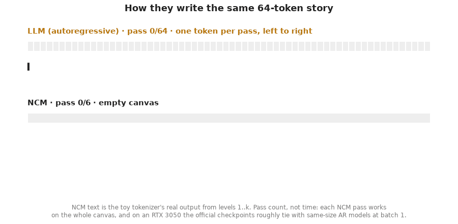
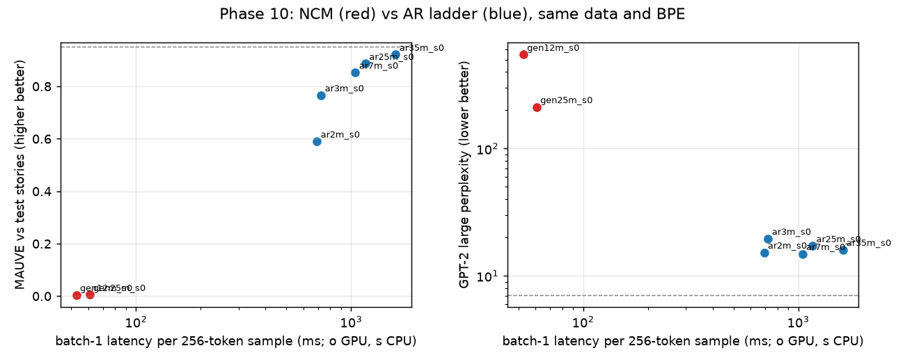

# I tried to reproduce a "31× faster" text generator on my laptop. Here is what I found.

> Draft written with Claude. Rewrite it in your own words before posting.

Hazy Research recently released **Next-Concept Modeling (NCM)**, a way to generate
text that does not write one token at a time. It was reported to be up to **31× faster**. I
am a final-year data science student with a gaming laptop (an RTX 3050 with 6 GB), and I
wanted to know what that number means for someone like me. In this project I benchmarked the
official models, built my own from scratch and trained them against ordinary language models
on the same data. Everything is in [the repository](https://github.com/Aymenrahmanii/NCM),
including every output and the scripts that recreate each number.

## How NCM writes

A normal language model (an "autoregressive" or AR model, like GPT) writes left to right, one
token per step. A 256-token story takes 256 steps.

NCM writes **coarse to fine**. First it predicts a single "gist" code for the whole text,
then a few codes, then more, level by level, until there is one code per token. Every code in
a level is predicted at the same time, so a 256-token story takes about 9 steps instead of 256.

Fewer steps sounds like it must be faster. It is not that simple: each NCM step processes the
whole text, while an AR step processes one new token.

## Lesson 1: check what the headline number is measured against

The 31× is against a *diffusion* language model that needs 128 or more steps, on a data-centre
H100, at 1,024-token outputs. That is a fair comparison for that paper, but it is not the
comparison most people have in mind, which is against GPT-style models.

On my laptop, against same-size AR models with the usual tricks (caching, compilation):

- With one request at a time, NCM is **1.2–1.7× faster** when both sides are compiled, and
  roughly ties when neither is.
- With 32 requests at once, NCM is **1.7–2.0× slower**. An AR model batches very well; NCM's
  advantage is using a GPU that would otherwise sit idle.
- On the CPU, NCM is **1.1–1.7× slower**. The speed comes from GPU parallelism, so it does not
  transfer to CPU-only devices.
- At long outputs (up to 1,024 tokens), NCM is 6–10× faster than GPT-2 small for a single
  request, but the lead does not grow with length.

Along the way I found a bug in the official cache code that made batched NCM look 2.5–4.5×
slower than it is (someone else had found the same bug and proposed the same fix upstream).
Measuring speed fairly turned out to be most of the work.

## Lesson 2: a fair fight needs the same training

The official NCM checkpoints were trained by their authors; the AR models I compared them to
were trained by other people on other data. So a quality gap could mean "NCM is worse" or just
"this checkpoint had less training".

To separate the two, I trained everything myself on the same data: all of TinyStories
(2.1 million short children's stories), the same tokenizer, the same optimizer and the same
200 million training positions. On one side, a 35M-parameter NCM. On the other, a ladder of
AR models from 1.9M to 35.9M parameters. I scored the stories with MAUVE, which measures how
close generated text is to real text (real stories score 0.95).

| model | time per story | MAUVE |
|---|---|---|
| real stories | – | 0.95 |
| AR, 35.9M | 1,610 ms | 0.92 |
| AR, 1.9M | 694 ms | 0.59 |
| **NCM, 35M** | **61 ms** | **0.006** |

NCM is about 20× faster, and its stories are broken. They start well ("Once upon a time,
there was a little girl named Lily.") and then stutter ("her her her mom her"). Even the
smallest AR model, 18× smaller, writes far better. This held over three training seeds, seven
decoding settings and a second, LLM-based judge.

## Lesson 3: when your result is bad, suspect yourself first

The released 125M NCM writes decent TinyStories (MAUVE 0.80). Mine scored 0.006. That is a big
enough gap that the honest first question is "did I build it wrong?"

I ran a diagnostic. Take a real story, convert it to NCM's codes, keep the real codes for the
first few levels and let the model write the rest. With my original design, the model failed
even when it only had to write **the last level**, with everything else given. My design
doubled the number of codes at each level, so the last level held half the text.

The official design spreads the text more evenly across levels, so I rebuilt my tokenizer
that way and retrained. The last level was fixed: given the coarser levels, the model now
writes it at nearly human quality (0.94). But the full stories were **still broken** (0.007).
The failure had moved to the coarse levels, the ones that decide what the story is about. The
model is good at refining a plan it is given and bad at making one.

So my first explanation was partly wrong, and finding that out was worth more than any of the
extra experiments I had planned. The conclusion stayed the same, with a better reason: at
this size, the method itself loses to AR, not my version of it. Whether it catches up at the
released model's size is a question my laptop cannot answer.

## Lesson 4: fine-tuning is the practical part

The good news is about adapting a released model to a new task. I fine-tuned the official
news-summary NCM to summarize chat dialogues (SAMSum), and the same for BART, a standard
summarizer. **LoRA** (training small add-on matrices instead of the whole model) at rank 16 on
every layer got within 1 ROUGE-L point of full fine-tuning on average while training under 3% of the
weights. The common default, rank 8 on two of the attention matrices, was 3–4 points short for
both models, so the default is worth questioning.

Fine-tuning did not make NCM competitive, though. It stayed 14 points behind BART and invented
a name that was not in the dialogue in a third of its summaries.

## What I take away

- **Ask what a speedup is measured against.** "31× faster" and "1.5× faster than what you
  would actually use" can both be true.
- **Speed and quality only make sense together.** A model that is 20× faster but writes
  broken text is not 20× better.
- **Train both sides yourself if you want to compare methods.** It is the only way to know
  whether you are comparing methods or checkpoints.
- **Test your own implementation hardest when the result is dramatic.** My first explanation
  of the failure was partly an artefact of my own design.

All of this ran on one laptop GPU, at small scale. The bigger question, whether NCM matches AR
at hundreds of millions of parameters, needs a bigger machine. If you have one, the training
and evaluation code is ready.
