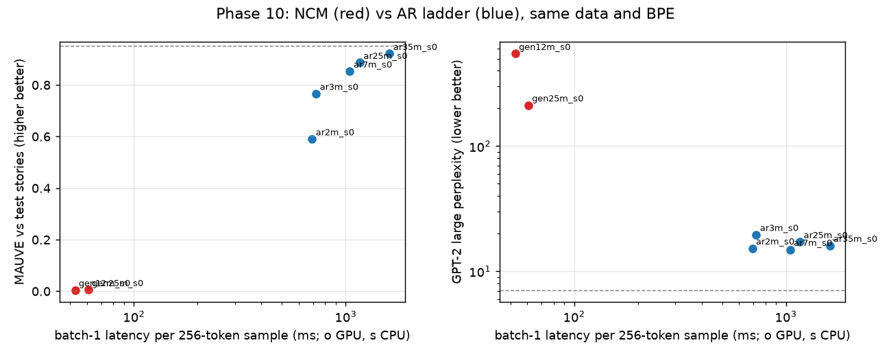

# Phase 10: controlled comparison and scale-up

> Draft written with Claude. Rewrite it in your own words.

The plan is in `docs/research-plan.md`. This file collects results as they come in.

## Diagnostic: which level breaks coherence? (2026-11-14, no training)

```bash
python -m ncm_lab.toy_ncm.diagnose     # ~5 min on the RTX 3050, ~1 GB
```

The Phase 2 toy NCM (tokenizer 8.6M, generator 5.6M, 64 tokens, levels 1/4/8/16/32/64)
reconstructs 98.7% of tokens, yet its samples have GPT-2 perplexity 372 against 13.5 for real
stories. So the damage happens in the generator. For 512 test stories, the real codes of levels
1..k are kept and the generator writes the rest; the result is decoded and judged by GPT-2
small, as in Phase 2. Rows use fixed seeds and reproduce exactly.

**Hypothesis (from the plan):** the cause is independent sampling of every position within a
level, not capacity, so more parameters alone will help only partly.

### Where it breaks

| real levels kept | levels generated | GPT-2 ppl (sampled, T=1) | greedy | token agreement (sampled) |
|---|---|---|---|---|
| 1..6 | 0 (reconstruction) | 15.5 | – | 99.0% |
| 1..5 | 1 (the 64-code level) | **111.3** | 57.8 | 67.7% |
| 1..4 | 2 | 184.2 | 74.4 | 42.6% |
| 1..3 | 3 | 231.0 | 69.2 | 27.3% |
| 1..2 | 4 | 248.6 | 62.8 | 20.1% |
| 1..1 | 5 | 285.3 | 52.7 | 14.8% |
| none | 6 (free sample) | 372.3 | 67.8 | 7.5% |

Generating **only the finest level**, with every coarser level real, multiplies perplexity by
7.2 (15.5 → 111). Each earlier level adds a factor between 1.1 and 1.7. Coherence breaks at
the last level, where 64 codes, one per token, are drawn in parallel.

Teacher-forced, the generator's top code matches the real one only 36% of the time at that
level (loss 3.12 nats per code), even with all coarser levels real:

| level | 1 | 2 | 3 | 4 | 5 | 6 |
|---|---|---|---|---|---|---|
| positions | 1 | 4 | 8 | 16 | 32 | 64 |
| top-1 code accuracy | 0.0% | 9.1% | 10.7% | 14.9% | 21.6% | 35.8% |
| loss (nats/code; uniform = 6.24) | 6.07 | 5.30 | 5.04 | 4.54 | 3.98 | 3.12 |

### How much decoding fixes

| setting | GPT-2 ppl | distinct-2 (real: 0.423) |
|---|---|---|
| real 1..5, last level T = 1 / 0.7 / 0.5 / 0.3 / greedy | 111 / 80 / 67 / 61 / 58 | 0.477 / 0.427 / 0.394 / 0.374 / 0.365 |
| free sample, all levels T = 1 | 372 | 0.594 |
| free sample, last level T = 0.7 / 0.5 / 0.3 | 262 / 207 / 181 | 0.526 / 0.471 / 0.436 |
| free sample, all levels T = 0.7 | **144** | 0.437 |
| free sample, all levels greedy | 68 | 0.002 (one story repeated) |

- Even greedy decoding of the last level, given every real coarser level, stays at 58,
  4× the reconstruction's 15.5. In log terms, decoding closes about a third of the gap the
  last level opens (ln 111/15.5 = 1.97; ln 58/15.5 = 1.32).
- Lowering every level's temperature to 0.7 cuts free-sample perplexity 2.6× (372 → 144) and
  brings distinct-2 to the real stories' level (0.437 vs 0.423), so it is a better default than
  T = 1, not a collapse. Fully greedy sampling collapses (distinct-2 0.002).

### Verdict

- **Where:** the finest level. This is the one the plan's ablations already target (two
  refinement passes on the last two levels, per-level temperature).
- **Why:** the hypothesis holds only partly. Independent sampling explains about a third of
  the damage at the finest level; the rest is that the generator does not know the right
  fine code (36% top-1 with perfect context). That is a capacity and data problem: Phase 2
  trained the 5.6M generator on about 19M tokens. **Scaling data and parameters, as Phase 10
  plans, is necessary, not optional.**
- **For the Phase 10 runs:** tune temperature per level on the validation split (0.7 is a good
  starting point here); keep greedy out, it collapses; report the finest-level teacher-forced
  accuracy as a cheap progress metric during training.

### Caveats

- One toy model, one seed per row, 512 stories, temperatures picked on the test split (this
  is a diagnostic; Phase 10 tunes on validation).
- GPT-2 small judges 64-token prefixes of stories; perplexity rewards repetition, hence
  distinct-2 next to it.
- Level 1 has a single position: its 0% top-1 accuracy and near-uniform loss mean the
  generator spreads probability over many "gist" codes, which is expected for an
  unconditional first level and not a failure by itself.

Files: `results/phase10_diag_summary.md`, `_levels.csv`, `_teacher_forced.csv`,
`_samples.txt` (three stories completed every way).

## Scale-up setup (2026-11-14)

```bash
python -m ncm_lab.scale.data                 # full TinyStories, 256 tokens, ~8 min CPU
bash scripts/phase10_train.sh                # tokenizer, 2 generators, 5 AR models
bash scripts/phase10_train.sh seeds          # seeds 1 and 2 of gen25m and ar25m
python -m ncm_lab.scale.evaluate quality     # T tuned on val by MAUVE, scored on test
python -m ncm_lab.scale.evaluate latency     # batch 1, GPU (add --device cpu)
python -m ncm_lab.scale.evaluate plot
```

- **Data:** 2,119,489 training stories, 424M non-pad tokens, cut to 256 tokens with the
  Phase 2 BPE (4096). Only 21% of stories fill all 256 positions, so a budget of 200M
  positions is about 160M real tokens. The official validation split is halved into `val`
  (10,995 stories, temperature tuning) and `test` (10,995).
- **Models** (code in `src/ncm_lab/scale/`, same design as the toy NCM):

  | model | width × layers | params |
  |---|---|---|
  | tokenizer, levels 1, 2, 4, …, 256, 512 codes each | 288 × (4 enc + 4 dec) | 10.7M |
  | gen12m / gen25m | 384 × 6 / 512 × 7 | 12.5M / 24.6M |
  | ar2m / ar3m / ar7m / ar25m / ar35m | 128×4 / 192×4 / 256×6 / 512×7 / 512×10 | 1.9 / 3.4 / 6.9 / 26.4 / 35.9M |

  ar35m matches the NCM's total footprint (tokenizer + gen25m = 35.3M).
- **Held constant:** AdamW (0.9, 0.95, wd 0.01), lr 5e-4, cosine with 300 warm-up steps,
  bf16, batch 64 × 256, clip 1.0. Tokenizer 100M positions, everything else 200M.
- **Resumable:** checkpoints every 250 steps; batches are seeded by (seed, step), so a
  stopped and resumed run is bit-identical to an uninterrupted one (tested).
- **Measured cost on the RTX 3050**, each model alone (two in one process spill past 6 GB):
  tokenizer ~0.5 h, gen12m 1.5 h, gen25m 2.4 h (micro-batch 32), AR ladder 9 h in total.
  About 24 GPU-hours with the extra seeds, against the plan's estimate of 55.

### Tokenizer result (100M positions, 32 min)

Token reconstruction on 1024 val stories when decoding from the first k levels:

| levels used | 1 | 2 | 3 | 4 | 5 | 6 | 7 | 8 | 9 |
|---|---|---|---|---|---|---|---|---|---|
| finest length | 1 | 2 | 4 | 8 | 16 | 32 | 64 | 128 | 256 |
| accuracy | 10.1% | 10.3% | 10.6% | 11.0% | 12.4% | 17.2% | 30.6% | 58.3% | **96.6%** |

It passes the 95% gate. As in the toy (45% at a quarter of the length, 73% at half), the
coarse levels carry little token-level detail: at a quarter and half of the length this one
gets 31% and 58%. The text is mostly written by the last two levels, the ones the
diagnostic found fragile. Log: `artifacts/scale/tokenizer/log.csv`.

## Result: NCM vs the AR ladder (2026-11-15)

Every model trained on the same 200M TinyStories positions with the same BPE and optimiser.
One sampling temperature per model, picked from 0.6–1.0 by MAUVE on 256 validation samples
(`results/phase10_tune.csv`). Then 512 test samples per model, scored against 5 disjoint
draws of 512 real test stories (`results/phase10_quality.csv`, samples in
`results/phase10_samples.jsonl`). Latency is the median of 20 batch-1 runs for one 256-token
sample on the RTX 3050 (`results/phase10_latency_cuda.csv`).

| model | params | T | GPU ms / story | MAUVE ↑ (± sd) | GPT-2-L ppl ↓ | distinct-2 |
|---|---|---|---|---|---|---|
| human test stories | – | – | – | 0.952 ± 0.015 | 7.1 | 0.44 |
| ar35m | 35.9M | 1.0 | 1610 | **0.921** ± 0.014 | 16.1 | 0.45 |
| ar25m | 26.4M | 1.0 | 1165 | 0.887 ± 0.033 | 17.2 | 0.45 |
| ar7m | 6.9M | 0.9 | 1046 | 0.853 ± 0.030 | 14.9 | 0.39 |
| ar3m | 3.4M | 0.9 | 725 | 0.767 ± 0.043 | 19.6 | 0.39 |
| ar2m | 1.9M | 0.8 | 694 | 0.590 ± 0.054 | 15.3 | 0.32 |
| NCM gen25m + tokenizer | 35.3M | 0.8 | **61** | 0.006 ± 0.001 | 212 | 0.51 |
| NCM gen12m + tokenizer | 23.2M | 1.0 | 53 | 0.005 ± 0.000 | 548 | 0.65 |



- **NCM fails on quality at this scale.** At the AR's own footprint (35M) it is two orders
  of magnitude below even the 1.9M AR model on MAUVE. Samples open fluently ("Once upon a
  time, there was a little girl named Lily.") and then stutter ("her her her mom her",
  "to to"): neighbouring tokens of the last level are sampled independently and disagree.
  The high distinct-2 is that noise, not diversity.
- **Doubling the generator barely helps** (MAUVE flat, perplexity 548 → 212), and the
  temperature sweep is flat (val MAUVE 0.006–0.008 at every T). Generator capacity is not
  the bottleneck.
- **The AR ladder is well behaved:** quality rises monotonically with size, and the larger
  models prefer T = 1.0.
- **The ~20× speed gap is an upper bound.** AR latency here is dominated by per-token Python
  and kernel-launch overhead (ar2m at 694 ms is barely faster than ar7m at 4× the
  parameters). A CUDA-graph or fused AR decoder would shrink the gap several-fold; NCM's
  9 forward passes have no such overhead to remove.

### Where the quality is lost (`python -m ncm_lab.scale.evaluate ceiling`)

512 test stories, disjoint from the MAUVE reference draws, are encoded to their real codes.
The first k levels are kept and gen25m samples the rest (`results/phase10_ceiling.csv`).

| levels kept real | generated | T | MAUVE ↑ | GPT-2-L ppl ↓ |
|---|---|---|---|---|
| 1–9 (tokenizer reconstruction) | none | – | **0.863** | 12.9 |
| 1–8 | 9 | greedy | 0.012 | 61.0 |
| 1–8 | 9 | 0.8 | 0.010 | 111.8 |
| 1–7 | 8–9 | 0.8 | 0.006 | 180.7 |
| 1–6 | 7–9 | 0.8 | 0.006 | 203.4 |
| none (normal sampling) | 1–9 | 0.8 | 0.006 | 212.4 |

- **The tokenizer is not the bottleneck:** its reconstructions reach 0.86 MAUVE (human
  ceiling 0.95), better than ar7m.
- **The last level is.** With every coarser level perfect, generating only the 256-code
  level drops MAUVE from 0.86 to 0.01. Levels 1–6 add almost nothing on top
  (ppl 181 → 212). This confirms, at 35M parameters and 200M tokens, the diagnostic above.
  It holds for this tokenizer's doubling schedule; the validity check below shows that an
  official-style schedule fixes the last level and moves the failure to the coarse ones.
- **Greedy is the ceiling for decoding.** The 256 last-level codes are predicted in one
  pass and never see each other, so with oracle context the best a sampling rule can do is
  pick each code's argmax: perplexity 61. Temperature per level, top-k or guidance change
  which independent choice is made, not the independence.

### Go / stop

The pre-registered kill rule: stop scaling if the 25M NCM with the best decoding is still
above 3× the perplexity of the AR model that matches its latency. No AR model is as fast;
the closest, ar2m (1.9M, 694 ms, 11× slower), has perplexity 15.3. NCM's best is 212 with
real sampling and 61 even with an oracle for levels 1–8, so ≥ 4× under the most generous
reading. **Verdict: stop.** Phase 11 (cheaper attention for a generator that does not yet
write fluent text) was skipped by this rule; it later ran as an exploratory study
(`docs/phase11.md`).

The honest claim from Phase 10 is the plan's third outcome: *a smaller AR model is both
faster and more fluent; NCM's speed costs quality at this scale.* The extras below (seeds,
decoding, a second judge) confirm it; the validity check revises *where* the quality is lost.

## Extras (2026-11-16 to 17)

### Three seeds (`results/phase10_quality_seeds.csv`)

Seeds 1 and 2 of gen25m and ar25m, same budget and tuning as seed 0:

| model | seed 0 | seed 1 | seed 2 | mean ± SD |
|---|---|---|---|---|
| ar25m | 0.887 | 0.931 | 0.935 | **0.918** ± 0.027 |
| NCM gen25m | 0.0060 | 0.0057 | 0.0061 | **0.0059** ± 0.0002 |

Seed 0 was ar25m's weakest seed, so the gap in the main table is, if anything, understated.

### Decoding ablations (`python -m ncm_lab.scale.evaluate ablate`)

Seven decoding settings for gen25m seed 0, 512 test samples each
(`results/phase10_ablations.csv`):

| setting | MAUVE ↑ | GPT-2-L ppl | distinct-2 |
|---|---|---|---|
| T = 0.8 (the tuned setting) | 0.0055 | 212 | 0.51 |
| T = 0.8, top-k 20 | 0.0068 | 127 | 0.42 |
| T = 0.8, top-k 5 | 0.0063 | 92 | 0.37 |
| T from 1.0 (level 1) down to 0.5 (level 9) | **0.0071** | 111 | 0.37 |
| T = 0.8, last level greedy | 0.0060 | 117 | 0.37 |
| T = 0.8, last two levels greedy | 0.0058 | 91 | 0.32 |
| greedy everywhere | 0.0041 | 48 | 0.002 (collapse) |

Narrower sampling trades diversity for perplexity, but no setting moves MAUVE off the floor.
Classifier-free guidance and extra refinement passes need a conditional or retrained
generator, so they are not in the list.

### A second judge: qwen2.5:3b (`python -m ncm_lab.scale.judge`)

A blind LLM coherence rating (1–5, temperature 0) on 200 test samples per model, 200 human
stories outside the MAUVE draws, and the same 200 with their sentences shuffled. Items are
shuffled and carry only an id (`results/phase10_judge.csv`, every reply parsed):

| group | mean (± SD) | rated 4 or 5 |
|---|---|---|
| human | **4.08** ± 0.71 | 79% |
| human, sentences shuffled | 3.17 ± 0.44 | 17% |
| ar25m / ar35m | 2.82 / 2.80 | 11% / 12% |
| ar2m / ar7m / ar3m | 2.73 / 2.70 / 2.54 | 4% / 4% / 1% |
| NCM gen25m / gen12m | 1.62 / 1.37 | 0% / 0% |

- The control passes: real stories score clearly above shuffled ones.
- The judge agrees with MAUVE on the main result: no NCM story gets a 4 or 5, and NCM is a
  point below even the 1.9M AR model.
- It is too coarse for anything finer. It barely separates the AR sizes (2.54–2.82, where
  MAUVE spreads 0.59–0.92) and rates shuffled human stories above every model, so it rewards
  well-formed sentences more than story order. A 3B judge is a check on the headline, not a
  replacement for MAUVE.

## Validity check: is this a weak reimplementation? (2026-11-16)

The released 125M TinyStories NCM reaches MAUVE 0.80 (Phase 9); ours gets 0.006. The largest
design difference is the level schedule: ours doubles (1, 2, 4, …, 256), so the last level
writes half the positions, while the official one grows by roughly equal steps. To test
whether that, rather than the method, explains Phase 10, a second tokenizer and generator
follow the official design scaled to 256 positions:

- **tokv2:** levels 1, 16, 32, 48, 64, 80, 104, 128, 152, 184, 216, 256 (12 levels), 4096 codes
  per level, 12.1M parameters, 100M positions.
- **Generator:** gen25m width and depth with output heads tied to the codebooks (logits from
  the distance to each code), 22.4M parameters, 100M positions. Compare it with
  `gen25m-attn-100m_s0` from Phase 11, the old tokenizer at the same budget.

Token accuracy of tokv2 when decoding from the first k levels (end of training):

| levels used | 3 | 5 | 7 | 8 | 9 | 10 | 11 | 12 |
|---|---|---|---|---|---|---|---|---|
| finest length | 32 | 64 | 104 | 128 | 152 | 184 | 216 | 256 |
| accuracy | 19.7% | 47.0% | 75.4% | 85.5% | 92.9% | 96.6% | 98.5% | **99.97%** |

At half the length it already rebuilds 85.5% of tokens, against 58.3% for the Phase 10
tokenizer, so the last levels now refine text instead of writing it.

Result (`results/phase10_quality_phase11.csv`): **MAUVE 0.0067** (ppl 130), against 0.0051 for
the old tokenizer at the same budget. Where it is lost
(`results/phase10_ceiling_gen25m-attn-100m-tokv2-tied_s0.csv`):

| levels kept real | generated | T | MAUVE ↑ | GPT-2-L ppl ↓ |
|---|---|---|---|---|
| 1–12 (reconstruction) | none | – | **0.953** | 7.4 |
| 1–11 | 12 | greedy | 0.939 | 8.5 |
| 1–11 | 12 | 0.8 | 0.939 | 8.9 |
| 1–10 | 11–12 | 0.8 | 0.903 | 12.5 |
| 1–9 | 10–12 | 0.8 | 0.569 | 21.2 |
| 1–7 | 8–12 | 0.8 | 0.039 | 53.3 |
| 1–5 | 6–12 | 0.8 | 0.011 | 105 |
| none | 1–12 | 0.6 | 0.007 | 130 |

- **The finest-level failure above was partly our schedule.** With the official-style
  schedule the generator writes the last level at near-human quality (0.94, against 0.01 for
  the old tokenizer) and the reconstruction itself matches human text (0.953 vs 0.952).
- **But the stories are still broken.** The failure moves to the coarse and middle levels:
  quality halves when the generator writes 3 levels and is gone by 5. The generator can
  refine a plan it is given; it cannot produce one.
- **So the Phase 10 verdict stands, with a narrower reason.** The low score is not an
  artefact of our level schedule, and not of decoding (above). At 25M parameters and
  100–200M positions, the NCM generator does not learn the coarse levels well enough. The
  official 125M model's 0.80 suggests scale is what is missing; this study cannot say
  whether NCM catches up with AR at matched scale.

Caveats: one seed and half budget for the v2 generator; tied heads and the new schedule
change together, so their separate effects are not identified.
