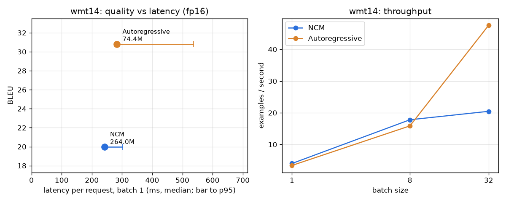

# Phase 4: testing the speed claim fairly

## Predictions (written 2026-10-26, before running the benchmark)

1. **NCM beats the AR baseline on latency at batch size 1** on both tasks, but by much less
   than 31×: the 31× figure is against a diffusion LM (AURORA-LM, 128+ steps), not against an
   AR model with a KV cache. Guess: 2–5×.
2. **NCM's advantage shrinks as batch size grows.** At batch 1 the AR model wastes the GPU on
   tiny per-token passes; at batch 32 each AR pass has more parallel work, so the gap closes.
3. **NCM's advantage is larger on XSum than on WMT14** if the AR summaries are longer than the
   AR translations (more sequential steps to avoid). It may also be smaller because XSum
   NCM reads a 512-token prefix in every one of its 8 passes.
4. **Quality:** NCM is close to BART-base on XSum ROUGE-L (paper: NCM 28.0 vs its own AR 24.4),
   but loses on WMT14 BLEU to opus-mt-de-en, which was trained on far more parallel data than
   WMT14 alone (paper: NCM 22.6 vs AR 25.2 even with matched data).
5. **Memory:** NCM uses more GPU memory than the AR baselines, because it carries a separate
   VQ-VAE tokenizer (60M for XSum, 144M for WMT14) on top of the generator.
6. **fp16 vs fp32:** small speedup, near-identical quality.

## Setup

- GPU: RTX 3050 6 GB laptop (WSL2), PyTorch 2.14.1+cu130.
- Same 500 test examples per task, same precision, seed 0, greedy decoding for every model.
- Timing covers generation only (`run`), after warm-up, with `torch.cuda.synchronize()`.
- XSum: NCM (88M generator + 60M VQ-VAE) vs `morenolq/bart-base-xsum` (140M). The AR model
  reads the same 512-token article prefix as text.
- WMT14 De→En: NCM (120M generator + 144M VQ-VAE) vs `Helsinki-NLP/opus-mt-de-en` (74M).

## Results

Run: `python -m ncm_lab.bench.run --task xsum|wmt14 --n 500 --precision fp16`, then
`python -m ncm_lab.bench.plot`. Raw numbers: `results/phase4_*_fp16.csv`; every output next to
its reference: `results/phase4_outputs_*.jsonl`; charts: `results/phase4_*_fp16.png`.

### Summarization (XSum, 500 test articles)

| | NCM | BART-base (AR) |
|---|---|---|
| parameters (incl. tokenizer) | 149M | 139M |
| ROUGE-1 / 2 / L | 34.7 / 12.9 / **27.8** | 40.9 / 17.9 / **33.5** |
| latency batch 1, median / p95 | 268 / 325 ms | 274 / 354 ms |
| throughput batch 1 / 8 / 32 (examples/s) | 3.7 / 5.0 / 5.0 | 3.7 / 19.6 / **43.0** |
| peak GPU memory batch 32 | 3.4 GB | 0.65 GB |

### Translation (WMT14 De→En, 500 test sentences)

| | NCM | opus-mt-de-en (AR) |
|---|---|---|
| parameters (incl. tokenizer) | 264M | 74M |
| BLEU | 20.0 | **30.8** |
| latency batch 1, median / p95 | **242 / 303 ms** | 283 / 536 ms |
| throughput batch 1 / 8 / 32 (examples/s) | **4.0 / 17.8** / 20.5 | 3.4 / 15.9 / **47.6** |
| peak GPU memory batch 32 | 3.8 GB | 0.24 GB |

### Where NCM's time goes (`scripts/phase4_profile.py`, ms per batch)

| stage | XSum b=1 | XSum b=32 | WMT14 b=1 | WMT14 b=32 |
|---|---|---|---|---|
| level passes (`net.generate`) | 210 | **7599** | 259 | 1446 |
| codes → vectors → token logits | 11 | 40 | 15 | 730 |
| picking tokens (penalties) | 23 | 411 | 0.5 | 35 |

Every level pass re-runs the whole transformer over the full input prefix (512 article
tokens for XSum) because this checkpoint's generation path has no KV cache. XSum does that
9 times. BART encodes the article **once** and then runs ~25 cheap decoder steps with a KV
cache. At batch 1 the GPU is under-used either way, so both take ~270 ms; at batch 32 the GPU
is full and NCM's 9× repeated prefix work dominates.

The official `generate()` does have `use_kv_cache=True` for WMT14. It is 1.5× faster but BLEU
drops from 20.0 to **3.8** on the same 500 sentences, so it is not a valid speedup for this
checkpoint.

### What "31×" means on an RTX 3050

The 31× is NCM against **AURORA-LM, a diffusion LM** that needs 128–184 denoising steps, on an
H100, generating 1024-token outputs at batch 16. NCM needs 8–11 steps, so against diffusion
models the step count alone explains a 10–20× gap. Against an **autoregressive** model of the
same size, which is what most people compare to, on this GPU with short outputs (20 words):

- **batch 1:** NCM is as fast (XSum) or 1.2× faster (WMT14), with a much tighter p95
  (fixed number of passes, independent of output length);
- **batch 32:** NCM is **2.3× (WMT14) to 8.7× (XSum) slower**;
- **quality:** the AR baselines win by 5.7 ROUGE-L and 10.8 BLEU. Caveat: both baselines are
  pretrained models (BART, OPUS data) fine-tuned for the task, while NCM was trained from
  scratch on the task data, so part of this gap is pretraining, not the method. The paper's
  matched-data AR baseline (Table 2) gets ROUGE-L 24.4 (NCM 28.0) and BLEU 25.2 (NCM 22.6).

### Predictions vs reality

| # | prediction | verdict |
|---|---|---|
| 1 | NCM faster at batch 1, 2–5× | **Wrong.** 1.0× (XSum), 1.2× (WMT14). Outputs are only ~20 words, so the AR model needs few steps. |
| 2 | gap shrinks as batch grows | **Right, and stronger than expected:** it flips, AR is 2–9× faster at batch 32. |
| 3 | bigger advantage on XSum (longer outputs) | **Wrong.** XSum is NCM's worst case because its 512-token prefix is re-processed in all 9 passes. |
| 4 | close on XSum, loses on WMT14 | **Half right.** Loses on both against pretrained baselines; matches the paper's own XSum number (27.8 vs 28.0). |
| 5 | NCM uses more memory | **Right:** 3.4–3.8 GB vs 0.2–0.7 GB at batch 32. |
| 6 | fp16: small speedup, same quality | **Right, bigger speedup than expected:** 2–2.5× (Phase 3). |

### Where NCM loses, and where it could win

- Loses: large batches, long inputs (repeated prefix work), short outputs, GPU memory,
  and quality against pretrained AR models.
- Could win: long outputs (an AR model needs one step per token; NCM's step count is fixed),
  latency-sensitive single requests with strict p95 targets, and against diffusion LMs.
  Testing 1024-token generation (the paper's setting) would need the unconditional
  OpenWebText/LM1B checkpoints, which we skipped to save disk space.
