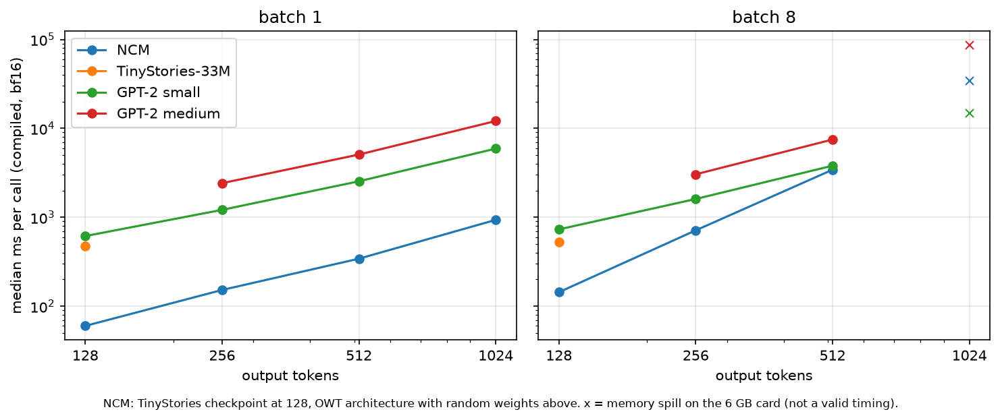

# Phase 9: long outputs

**Question:** does NCM win at batch 1 when outputs are long? The paper times 1,024-token
unconditional generation; Phases 3–8 only covered conditional tasks with 64-token outputs.

```bash
export NCM_ROOT=third_party/ncm-pr5-pr4
python -m ncm_lab.bench.long_outputs quality             # 5 seeds x 256 samples per model
python -m ncm_lab.bench.long_outputs mauve               # needs data/tinystories_text/
python -m ncm_lab.bench.long_outputs speed --length 512  # also 128, 256, 1024, and --eager
python -m ncm_lab.bench.long_outputs plot
```

## What changed from the plan

- **The 1,024-token OpenWebText checkpoint is not released.** Its Hub folder holds only a
  `TODO.md`, and every released unconditional checkpoint has a 128-token canvas. So:
  - **quality** is measured at 128 tokens with the real TinyStories NCM (125M);
  - **speed above 128 tokens** uses upstream's OWT architecture (`config/eval/owt.yaml`) with
    **random weights**, its level schedule cut at the target length (317M at 256, 349M at 512,
    390M at 1024). Latency does not depend on the weights: the number of passes, the shapes
    and the sampling work are fixed by the config.
- **bf16, not fp16:** fp16 overflows in the sampling checkpoints (device-side assert in
  TinyStories). Both sides run bf16 with bf16 weights.
- **Sampling:** pure ancestral sampling for every model (temperature 1, no top-k, top-p 1.0),
  the setting of upstream's `eval_shard.py`. NCM's level 0 is drawn from the checkpoint's
  unigram, as upstream does.
- **Baselines:** TinyStories-33M (68.5M, in-domain) and GPT-2 small (124M) at 128 tokens;
  GPT-2 small and GPT-2 medium (355M, the size match for the OWT architecture) above.
  Every AR model is compiled with a static cache and forced to write exactly L tokens.
- **Protocol:** the interleaved one from Phase 4 (warm-up, rotating order, paired-bootstrap
  CIs on the ratio of medians). 50–100 calls per point at batch 1, 30–50 at batch 8.

## Quality at 128 tokens (real weights)

1,280 samples per model (5 seeds × 256). Generative perplexity under GPT-2 large (upstream's
`evaluation/gen_ppl.py`); unigram entropy in nats on GPT-2 tokens so it compares across
tokenizers; ± is the SD across seeds.

| Model | Params | genPPL ↓ | Entropy | Words | MAUVE ↑ |
|---|---|---|---|---|---|
| NCM (TinyStories) | 125M | 16.52 ± 0.35 | 3.989 ± 0.011 | 103.7 | 0.797 ± 0.042 |
| TinyStories-33M | 68.5M | 9.96 ± 0.14 | 4.000 ± 0.005 | 99.9 | 0.949 ± 0.006 |
| GPT-2 small | 124M | 91.06 ± 2.73 | 4.264 ± 0.034 | 83.8 | 0.022 ± 0.002 |
| Human (TinyStories valid) | – | – | – | – | 0.957 ± 0.007 |

NCM's entropy on its own tokens is 3.976, so its text is not degenerate. It matches the
in-domain AR model's diversity (−0.011 nats) at 1.66× its perplexity. GPT-2 small is out of
domain here; it is in the table for speed context only.

MAUVE compares each model's 1,280 samples with 5 disjoint draws of 1,280 human stories
(TinyStories validation, cut to 128 GPT-2 tokens; GPT-2 large features); ± is the SD across
draws. The human row scores one draw against the other four, so about 0.96 is the ceiling.
TinyStories-33M is close to that ceiling (0.949). NCM is clearly below it (0.797) and varies
more across draws, so its samples are distinguishable from human stories in a way the
in-domain AR model's are not. Perplexity and MAUVE agree; entropy alone would have missed
the gap. GPT-2 small scores 0.02, as expected for web text against children's stories.

## Speed against output length (compiled, bf16)



Median ms per call; NCM ÷ AR is the paired ratio of medians with its 95% CI.

**Batch 1**

| Tokens | NCM | GPT-2 small | GPT-2 medium | NCM ÷ small | NCM ÷ medium |
|---|---|---|---|---|---|
| 128 | 60 | 615 | – | 0.098 [0.087, 0.100] | – |
| 256 | 152 | 1,212 | 2,420 | 0.126 [0.122, 0.128] | 0.063 [0.062, 0.064] |
| 512 | 342 | 2,540 | 5,076 | 0.135 [0.132, 0.136] | 0.067 [0.066, 0.068] |
| 1024 | 935 | 5,919 | 12,103 | 0.158 [0.153, 0.162] | 0.077 [0.076, 0.079] |

At 128 tokens TinyStories-33M takes 477 ms (NCM ÷ it = 0.126).

**Batch 8**

| Tokens | NCM | GPT-2 small | GPT-2 medium | NCM ÷ small | NCM ÷ medium |
|---|---|---|---|---|---|
| 128 | 144 | 731 | – | 0.197 [0.189, 0.204] | – |
| 256 | 713 | 1,606 | 3,043 | 0.444 [0.436, 0.450] | 0.234 [0.231, 0.237] |
| 512 | 3,426 | 3,802 | 7,490 | 0.901 [0.874, 0.927] | 0.457 [0.444, 0.472] |
| 1024 | *spill* | *spill* | *spill* | – | – |

At 1,024 tokens and batch 8 the card sat at 5.7–5.96 of 6 GB and the driver spilled to
system memory: GPT-2 medium went from 7.5 s at 512 tokens to 85.8 s, with very wide CIs.
Those timings are kept in `results/phase9_speed_1024.csv` but are not valid; the point needs
a bigger GPU.

**Eager (no compile), batch 1**

| Tokens | NCM | GPT-2 small | GPT-2 medium | NCM ÷ small | NCM ÷ medium |
|---|---|---|---|---|---|
| 128 | 423 | 2,640 | – | 0.160 [0.149, 0.184] | – |
| 1024 | 1,531 | 15,051 | 26,614 | 0.102 [0.098, 0.105] | 0.058 [0.056, 0.059] |

At 128 tokens eager, every model was faster at batch 8 than at batch 1 (NCM 338 vs 423 ms);
batch 1 was also the noisier run (p95 1.8× the median). Read the eager 128 batch-1 row as
approximate. Eager batch 8 at 1,024 tokens was stopped: it hits the same memory limit.

## What it means

1. **At batch 1, NCM wins at every length:** 6–10× faster than GPT-2 small, and 13–16×
   faster than the size-matched GPT-2 medium (16× at 256 tokens, 13× at 1,024). This is the regime the paper's claim is about, and here it holds on a 6 GB laptop
   GPU.
2. **The advantage does not grow with length; it shrinks slowly.** NCM's time grows 2.25×
   and then 2.7× per doubling from 256 tokens (likely because each level attends over all the
   coarser levels before it), AR's 2.0–2.4×. NCM ÷ GPT-2 small goes 0.126 → 0.135 → 0.158
   from 256 to 1,024 tokens. NCM's win comes from its fixed number of passes, which pays off
   at *any* length once decoding is the bottleneck, not specifically at long outputs.
3. **Batching erases it.** At batch 8 NCM ÷ GPT-2 small rises 0.20 → 0.44 → 0.90 from 128 to
   512 tokens; the extrapolated break-even is a little above 512 tokens (around 1,024 against
   GPT-2 medium). Same lesson as Phase 8: NCM's passes are wide and become compute-bound,
   AR's steps are narrow and batch almost for free.
4. **Compiling helps AR more.** From eager to compiled at 1,024 tokens, AR speeds up 2.5×
   (GPT-2 small) and 2.2× (medium); NCM 1.6×. Eager-vs-eager comparisons overstate NCM.
5. **Quality is only measurable at 128 tokens.** There NCM matches the in-domain AR model's
   diversity, but its perplexity is 1.66× higher and its MAUVE 0.80 vs 0.95. Nothing here says what a trained 1,024-token
   NCM would write.

## Against the plan's criteria

- **Success** ("≥ 3× faster at 1,024 tokens, entropy within 0.2 nats of GPT-2"): the speed
  half holds at batch 1 (6.3× vs GPT-2 small, 13× vs medium), but on random weights. The
  entropy half compared against the wrong model: GPT-2 is out of domain on TinyStories. Against
  the in-domain TinyStories-33M, NCM is within 0.011 nats at 128 tokens. **Verdict: met for
  speed at batch 1, untested for quality at 1,024 tokens** (no checkpoint).
- **Kill** ("checkpoint does not fit in 6 GB at batch 1"): batch 1 fits at every length
  (about 4.8 GB in use at 1,024 tokens with all three models loaded, including the 1.9 GB
  the desktop takes); batch 8 at 1,024 does not.

## Caveats

- Random weights above 128 tokens: valid for latency, says nothing about quality.
- top-p = 1.0 may still make Hugging Face sort the vocabulary at every step; that cost was
  not measured separately and counts against AR.
- One GPU (RTX 3050 laptop, 6 GB), bf16 only. Windows takes 1.9 GB of the card.
- To finish this phase properly, ask the authors for the OWT checkpoint (or its config and
  training recipe) and rerun `quality` at 1,024 tokens against GPT-2 medium on OpenWebText.
