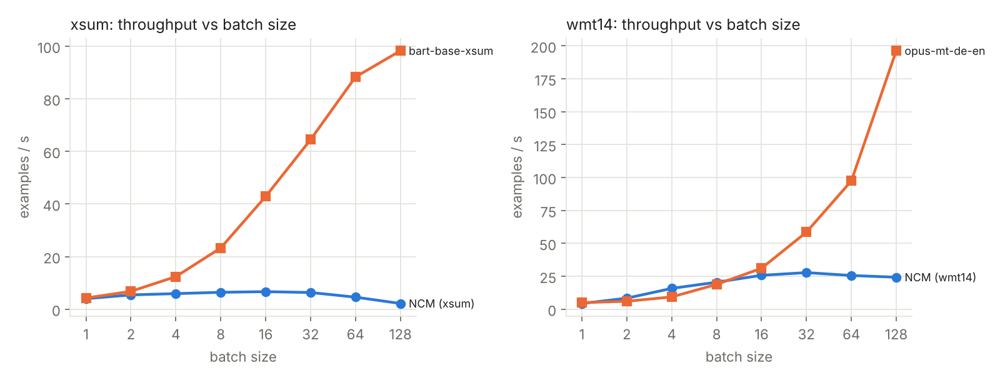
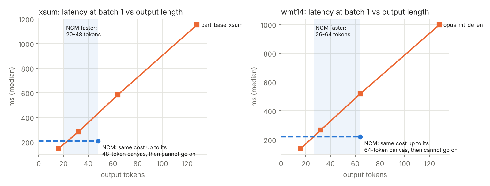

# Limits of NCM: results

Generated by `python -m ncm_lab.limits.report` from `results/limits_*.csv`.

## Throughput and memory vs batch size

| task | model | batch_size | examples_per_s | ms_per_batch | peak_MB | oom |
|---|---|---|---|---|---|---|
| xsum | NCM (xsum) | 1 | 3.99 | 250.7 | 1017 | False |
| xsum | NCM (xsum) | 2 | 5.43 | 368.6 | 1095 | False |
| xsum | NCM (xsum) | 4 | 5.92 | 675.6 | 1254 | False |
| xsum | NCM (xsum) | 8 | 6.42 | 1246.2 | 1565 | False |
| xsum | NCM (xsum) | 16 | 6.67 | 2399.7 | 2148 | False |
| xsum | NCM (xsum) | 32 | 6.34 | 5051.0 | 2740 | False |
| xsum | NCM (xsum) | 64 | 4.57 | 14003.1 | 4723 | False |
| xsum | NCM (xsum) | 128 | 2.17 | 59100.6 | 6779 | False |
| xsum | bart-base-xsum | 1 | 4.25 | 235.6 | 295 | False |
| xsum | bart-base-xsum | 2 | 6.78 | 294.8 | 306 | False |
| xsum | bart-base-xsum | 4 | 12.38 | 323.2 | 329 | False |
| xsum | bart-base-xsum | 8 | 23.29 | 343.5 | 374 | False |
| xsum | bart-base-xsum | 16 | 42.85 | 373.4 | 464 | False |
| xsum | bart-base-xsum | 32 | 64.47 | 496.3 | 644 | False |
| xsum | bart-base-xsum | 64 | 88.3 | 724.8 | 1005 | False |
| xsum | bart-base-xsum | 128 | 98.26 | 1302.7 | 1727 | False |
| wmt14 | NCM (wmt14) | 1 | 4.3 | 232.5 | 1540 | False |
| wmt14 | NCM (wmt14) | 2 | 8.32 | 240.3 | 1611 | False |
| wmt14 | NCM (wmt14) | 4 | 15.75 | 254.0 | 1751 | False |
| wmt14 | NCM (wmt14) | 8 | 20.46 | 391.0 | 2045 | False |
| wmt14 | NCM (wmt14) | 16 | 25.7 | 622.6 | 2583 | False |
| wmt14 | NCM (wmt14) | 32 | 27.76 | 1152.9 | 3630 | False |
| wmt14 | NCM (wmt14) | 64 | 25.56 | 2504.0 | 5135 | False |
| wmt14 | NCM (wmt14) | 128 | 24.24 | 5280.3 | 9442 | False |
| wmt14 | opus-mt-de-en | 1 | 4.92 | 203.4 | 154 | False |
| wmt14 | opus-mt-de-en | 2 | 5.98 | 334.7 | 156 | False |
| wmt14 | opus-mt-de-en | 4 | 9.26 | 431.8 | 161 | False |
| wmt14 | opus-mt-de-en | 8 | 18.79 | 425.7 | 172 | False |
| wmt14 | opus-mt-de-en | 16 | 31.05 | 515.2 | 193 | False |
| wmt14 | opus-mt-de-en | 32 | 58.48 | 547.2 | 236 | False |
| wmt14 | opus-mt-de-en | 64 | 97.43 | 656.9 | 316 | False |
| wmt14 | opus-mt-de-en | 128 | 196.31 | 652.0 | 482 | False |

- xsum: bart-base-xsum overtakes NCM (xsum) from batch size 1.

- wmt14: opus-mt-de-en overtakes NCM (wmt14) from batch size 16.

## Output length where AR becomes slower than NCM

| task | batch_size | ncm_ms | ar_ms_fixed | ar_ms_per_token | breakeven_tokens | ncm_canvas_tokens |
|---|---|---|---|---|---|---|
| xsum | 1 | 209.3 | 37.7 | 8.376 | 20 | 48 |
| xsum | 8 | 982.0 | 29.7 | 9.165 | 104 | 48 |
| wmt14 | 1 | 219.3 | 16.8 | 7.693 | 26 | 64 |
| wmt14 | 8 | 318.3 | -10.1 | 9.808 | 33 | 64 |

## Translation quality vs input length

| model | sentences_per_input | input_words | input_tokens | share_truncated | bleu | chrf | length_ratio |
|---|---|---|---|---|---|---|---|
| NCM (wmt14) | 1 | 17.9 | 35.6 | 0.0 | 16.31 | 44.8 | 0.91 |
| NCM (wmt14) | 2 | 33.6 | 67.6 | 0.15 | 10.09 | 34.6 | 0.639 |
| NCM (wmt14) | 3 | 51.4 | 103.3 | 0.54 | 2.62 | 19.34 | 0.368 |
| NCM (wmt14) | 4 | 71.2 | 142.5 | 0.85 | 1.08 | 15.56 | 0.277 |
| NCM (wmt14) | 6 | 108.5 | 217.8 | 1.0 | 0.23 | 12.07 | 0.194 |
| NCM (wmt14) | 8 | 140.4 | 281.4 | 1.0 | 0.04 | 9.1 | 0.145 |
| opus-mt-de-en | 1 | 17.9 | 27.2 | 0.0 | 24.65 | 53.79 | 0.94 |
| opus-mt-de-en | 2 | 33.6 | 49.9 | 0.0 | 28.08 | 56.63 | 0.926 |
| opus-mt-de-en | 3 | 51.4 | 75.3 | 0.0 | 31.09 | 58.44 | 0.907 |
| opus-mt-de-en | 4 | 71.2 | 104.1 | 0.0 | 31.32 | 59.31 | 0.925 |
| opus-mt-de-en | 6 | 108.5 | 158.9 | 0.0 | 31.46 | 60.38 | 0.925 |
| opus-mt-de-en | 8 | 140.4 | 206.8 | 0.0 | 29.69 | 58.68 | 0.895 |

## Invented numbers, names and repetition

| task | model | n | share_invented_number | share_invented_name | share_repetition | share_any |
|---|---|---|---|---|---|---|
| xsum | NCM | 500 | 0.202 | 0.562 | 0.378 | 0.802 |
| xsum | AR baseline | 500 | 0.114 | 0.512 | 0.054 | 0.588 |
| wmt14 | NCM | 500 | 0.038 | 0.214 | 0.364 | 0.5 |
| wmt14 | AR baseline | 500 | 0.0 | 0.074 | 0.134 | 0.196 |

## Quality under noisy input

| task | model | perturbation | rougeL | bleu | drop_vs_clean |
|---|---|---|---|---|---|
| xsum | NCM (xsum) | clean | 27.53 |  | 0.0 |
| xsum | NCM (xsum) | typos_10pct | 27.47 |  | 0.06 |
| xsum | NCM (xsum) | typos_30pct | 24.28 |  | 3.25 |
| xsum | NCM (xsum) | lowercase | 22.64 |  | 4.89 |
| xsum | NCM (xsum) | uppercase | 5.12 |  | 22.41 |
| xsum | NCM (xsum) | no_punctuation | 21.21 |  | 6.32 |
| xsum | bart-base-xsum | clean | 32.69 |  | 0.0 |
| xsum | bart-base-xsum | typos_10pct | 31.83 |  | 0.86 |
| xsum | bart-base-xsum | typos_30pct | 29.34 |  | 3.35 |
| xsum | bart-base-xsum | lowercase | 28.42 |  | 4.27 |
| xsum | bart-base-xsum | uppercase | 13.14 |  | 19.55 |
| xsum | bart-base-xsum | no_punctuation | 29.29 |  | 3.4 |
| wmt14 | NCM (wmt14) | clean |  | 18.76 | 0.0 |
| wmt14 | NCM (wmt14) | typos_10pct |  | 15.76 | 3.0 |
| wmt14 | NCM (wmt14) | typos_30pct |  | 14.11 | 4.65 |
| wmt14 | NCM (wmt14) | lowercase |  | 12.94 | 5.82 |
| wmt14 | NCM (wmt14) | uppercase |  | 0.28 | 18.48 |
| wmt14 | NCM (wmt14) | no_punctuation |  | 11.84 | 6.92 |
| wmt14 | opus-mt-de-en | clean |  | 27.5 | 0.0 |
| wmt14 | opus-mt-de-en | typos_10pct |  | 24.75 | 2.75 |
| wmt14 | opus-mt-de-en | typos_30pct |  | 21.74 | 5.76 |
| wmt14 | opus-mt-de-en | lowercase |  | 21.58 | 5.92 |
| wmt14 | opus-mt-de-en | uppercase |  | 2.21 | 25.29 |
| wmt14 | opus-mt-de-en | no_punctuation |  | 20.59 | 6.91 |

## Sudoku out of distribution

| set | solver | n | correct | valid_solution | full_grid_returned | said_unsolvable | ms_per_puzzle |
|---|---|---|---|---|---|---|---|
| hard | exact solver (CPU) | 100 | 1.0 | 1.0 | 1.0 | 0.0 | 0.64 |
| shuffled | exact solver (CPU) | 100 | 1.0 | 1.0 | 1.0 | 0.0 | 0.67 |
| fewer_clues_5 | exact solver (CPU) | 100 | 1.0 | 1.0 | 1.0 | 0.0 | 2.2 |
| fewer_clues_15 | exact solver (CPU) | 100 | 0.99 | 0.99 | 0.99 | 0.0 | 142.37 |
| unsolvable | exact solver (CPU) | 100 | 1.0 | 0.0 | 0.0 | 1.0 | 0.01 |
| already_solved | exact solver (CPU) | 100 | 1.0 | 1.0 | 1.0 | 0.0 | 0.04 |
| hard | NCM sudoku-hard | 100 | 0.84 | 0.84 | 1.0 | 0.0 | 16.15 |
| shuffled | NCM sudoku-hard | 100 | 0.85 | 0.85 | 1.0 | 0.0 | 16.07 |
| fewer_clues_5 | NCM sudoku-hard | 100 | 0.32 | 0.32 | 1.0 | 0.0 | 16.45 |
| fewer_clues_15 | NCM sudoku-hard | 100 | 0.01 | 0.01 | 1.0 | 0.0 | 16.37 |
| unsolvable | NCM sudoku-hard | 100 | 0.0 | 0.0 | 1.0 | 0.0 | 16.98 |
| already_solved | NCM sudoku-hard | 100 | 0.0 | 0.0 | 1.0 | 0.0 | 16.52 |

